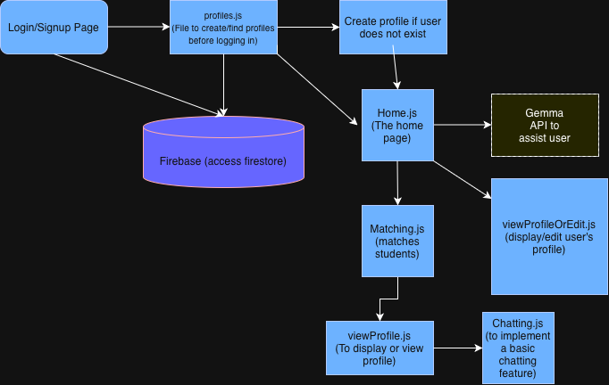

# ConnectYou

A project for CS19300 Class that connects STEM and Business Majors together to offer a collaborative environment for overlapping skills.

## The Problem

Business and STEM majors have complimentary skills but often struggle to find people of similar interests through colleges. Most students just rely on luck or their friends to find a teammate with similar interest or skill. This project simplifies that search by linking business and STEM majors with overlapping and shared interests, so as to amplify a collaborative environment.

## How It Works


- [System Diagram (PDF)](docs/Eisenhower_Matrix.pdf)

## Tech Stack

- **Language:** JavaScript, HTML, CSS 
- **Libraries:** ReactJs, Tailwind CSS
- **External tools:** Github (git), Firebase (Firestore), GEMMA API.

## Setup


```bash
git clone https://github.com/Garvit-M07/ConnectYou.git
cd ConnectYou
npm install
cp .env.example .env #fill your own firebase values
npm run dev
```

## Usage

How to actually run the thing, with examples.

```bash
./backup.sh ~/Documents
```

## Roadmap

- [ ] Gemma integration to assist users
- [ ] Resume upload and parsing
- [ ] Scheduling a meeting/call
- [ ] Analytics

## Author

Garvit Maheshwari - [github.com/Garvit-M07](https://github.com/Garvit-M07)

